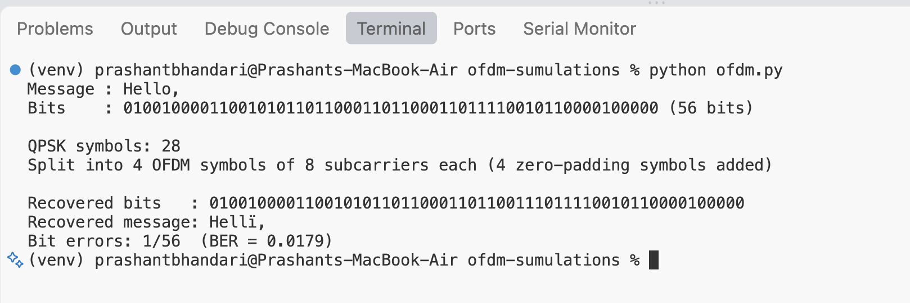
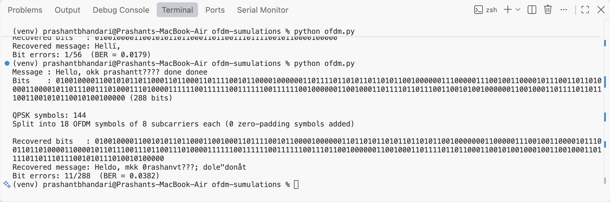

# OFDM Simulations

This project demonstrates a basic digital communication link using **Orthogonal Frequency Division Multiplexing (OFDM)** and **Quadrature Phase Shift Keying (QPSK)**. A text message is converted into bits, mapped to QPSK symbols, divided across eight OFDM subcarriers, transmitted through an additive white Gaussian noise (AWGN) channel, and reconstructed at the receiver.

The receiver uses an FFT to recover the subcarrier symbols and a nearest-point QPSK demapper to convert them back into bits and text.

## Paper
This project is described in a technical report:
**An End-to-End OFDM–QPSK Text Link in Plain NumPy: Implementation and Bit-Error-Rate Validation Against Theory** — **Prashant Bhandari**, 2026. [Read the paper](https://www.researchgate.net/publication/418396869) · DOI: [10.13140/RG.2.2.19175.07844](https://doi.org/10.13140/RG.2.2.19175.07844)

## Simulation Setup

- Modulation: QPSK
- Number of subcarriers per OFDM symbol: 8
- Channel: AWGN
- Noise power: 0.05
- Processing stages: text -> bits -> QPSK -> IFFT -> AWGN -> FFT -> QPSK demapping -> text
- Bit error rate (BER): number of incorrect bits divided by the total number of transmitted bits

## Experiment 1: Short Message

### Input and transmission

The input message was `Hello,`, which contains 7 characters or 56 bits. QPSK maps two bits to each symbol, producing 28 QPSK symbols. Since each OFDM symbol uses 8 subcarriers, the data is transmitted in 4 OFDM symbols. Four zero-padding symbols are added so that the QPSK data fits exactly into complete OFDM blocks.

### Results

- Original message: `Hello,`
- Recovered message: `Helli,`
- Bit errors: 1 out of 56
- BER: 0.0179

The recovered message is almost identical to the original. One bit was changed by the AWGN channel, which caused the final character to be received incorrectly. This shows that the OFDM and QPSK processing chain is working, but the system is not completely error-free at the selected noise level.

### Conclusion

For a short message, the simulation achieved reliable transmission with only one bit error. The low BER indicates that the received signal remained close enough to the transmitted QPSK constellation points for most bits to be decoded correctly.

## Experiment 2: Longer Message

### Input and transmission

The second input was a longer message:

`Hello, okk prashantt???? done donee`

This message contains 36 characters or 288 bits. The data produces 144 QPSK symbols, which are transmitted using 18 OFDM symbols with 8 subcarriers each. No zero-padding is required because 144 is exactly divisible by 8.

### Results

- Original message: `Hello, okk prashantt???? done donee`
- Recovered message: `Heldo, mkk 0rashanvt???; dole"donat`
- Bit errors: 11 out of 288
- BER: 0.0382

The longer transmission contains more incorrect characters because it carries more bits through the same noisy channel. Although the BER is still relatively small, the errors accumulate across the message and make the recovered text noticeably different from the input.

### Conclusion

The longer-message experiment confirms that transmission errors become more visible as the amount of data increases. The OFDM structure successfully handles multiple blocks, but AWGN causes some QPSK symbols to move close to or across decision boundaries. Without error correction, even a modest number of bit errors can corrupt several characters.

## Overall Conclusion

Both experiments demonstrate the complete OFDM communication process successfully: the messages are converted to symbols, transmitted over a noisy channel, and reconstructed at the receiver. The short message produced a BER of 0.0179, while the longer message produced a BER of 0.0382. The difference shows that the number of observed errors depends on the random noise realization and the amount of transmitted data.

For improved performance, the simulation could be extended with a lower noise power, channel coding or error-correction bits, a cyclic prefix, pilot subcarriers, and multiple runs to calculate an average BER.
